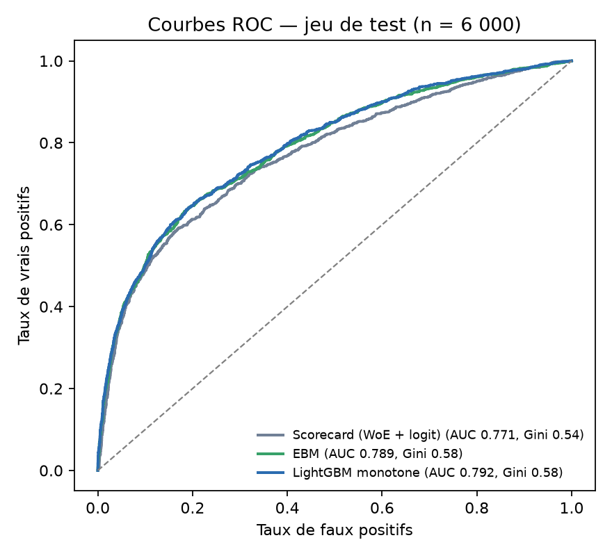
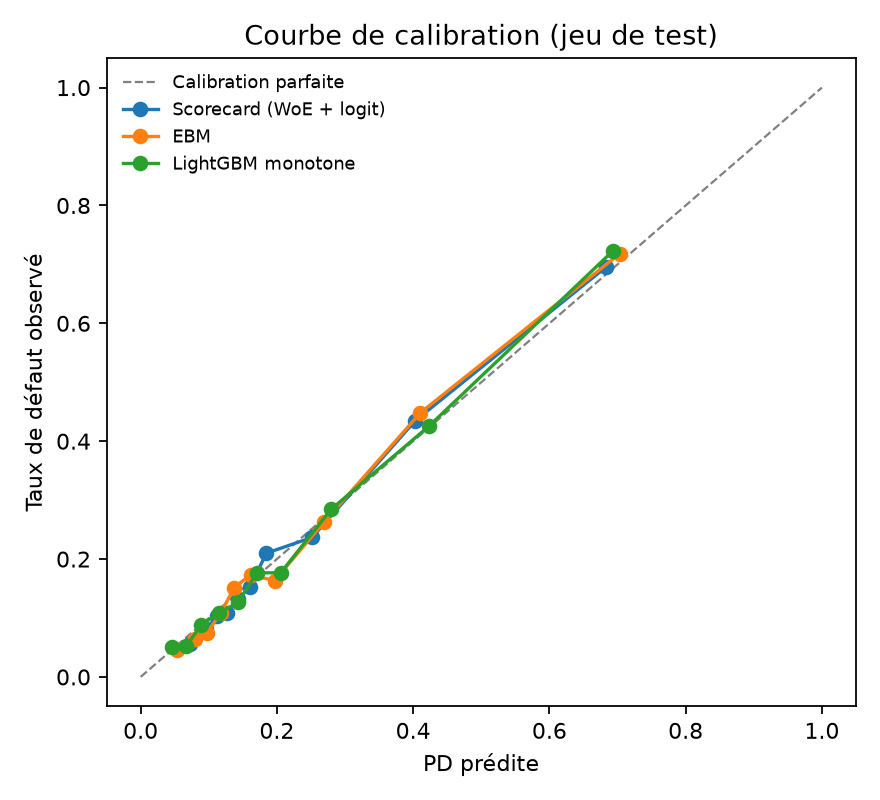
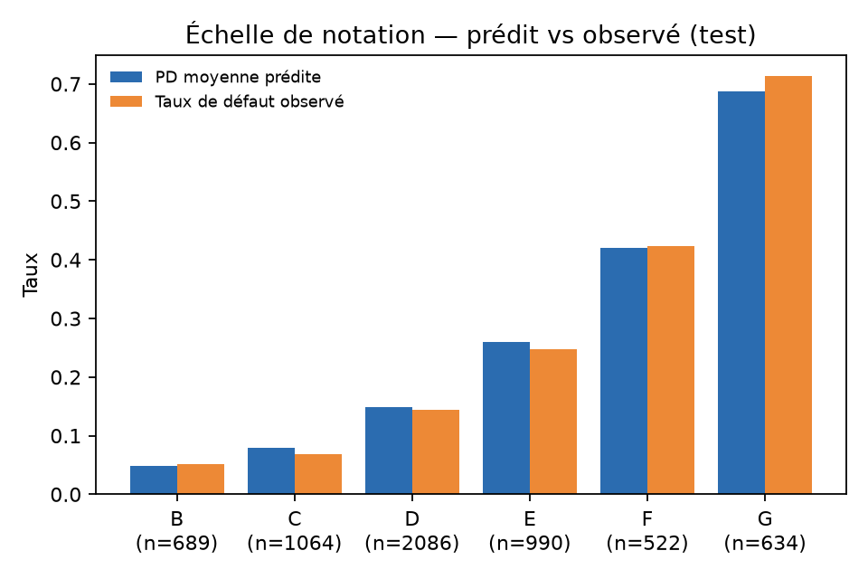
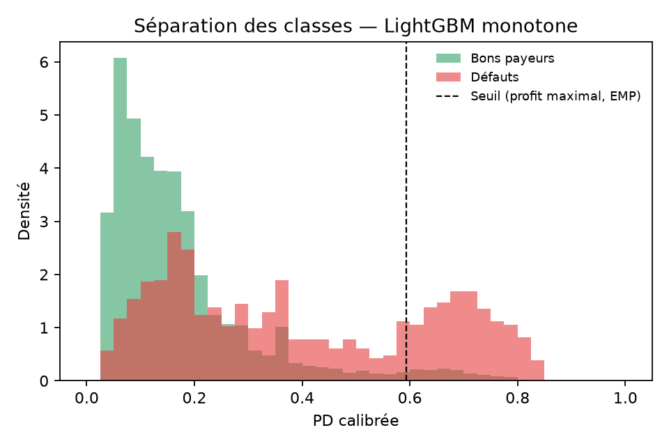
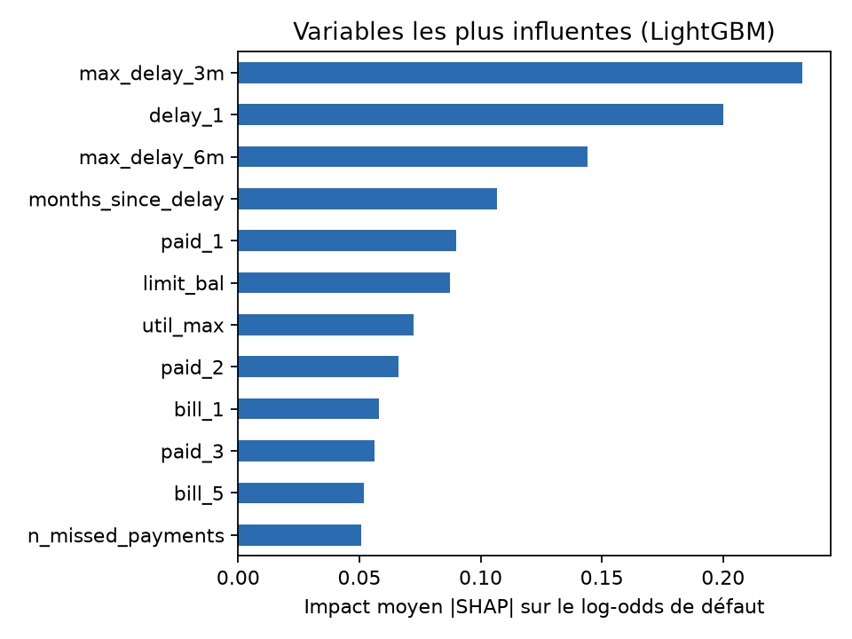

# Credit Scoring Lab: explainable, governed probability-of-default model

An end-to-end probability-of-default (PD) model built the way a bank risk team would build it.
- **Models:** the regulatory **scorecard** banks deploy, compared with modern **interpretable machine learning**.
- **Governance:** the controls the **EU AI Act** expects for high-risk credit systems (calibration, profit-based cut-off, a "refer to analyst" zone with statistical guarantees, a fairness audit, stability monitoring, French reason codes).
- **Demo:** a loan-officer app.

Every number below comes from code in this repo (`python run_all.py`). The test set was scored once, at the end.

> **Résumé (FR)** — Modèle de probabilité de défaut de bout en bout sur 30 000 clients de cartes de crédit. Il compare une grille de score réglementaire (WoE + régression logistique) à des modèles de machine learning interprétables (EBM, LightGBM à contraintes monotones). Il comprend aussi calibration, seuil d'octroi par profit maximal (EMP), échelle de notation et perte attendue, une zone « à valider par un analyste » avec garantie statistique (prédiction conforme), un audit d'équité, un suivi de stabilité (PSI), des motifs de décision en français et une application Streamlit pour le chargé de clientèle.



## Results (held-out test set, n = 6,000, default rate 22.1%)

| Model | AUC [95% CI] | Gini | KS | Brier |
|---|---|---|---|---|
| Scorecard: optimal binning + WoE + logistic regression (11 variables, 466–621 points) | 0.771 [0.757–0.785] | 0.542 | 0.422 | 0.136 |
| Explainable Boosting Machine (glass-box) | 0.789 [0.775–0.803] | 0.577 | 0.450 | 0.132 |
| **LightGBM with monotonic constraints** (champion) | **0.792** [0.778–0.806] | **0.583** | **0.450** | **0.131** |

- **Is the gain over the scorecard real?** Yes. LightGBM adds **+0.021 AUC**, with a paired bootstrap 95% CI of [+0.014, +0.028]. EBM adds +0.018 [+0.011, +0.024].
- **How the champion was chosen:** on validation AUC, never on test.
- **Monotonic behaviour:** more payment delay can never lower the predicted risk. I checked this on 200 random applicants, by varying the latest delay from 0 to 8 months, and found **0 violations**.
- **Calibration:** all three models are well calibrated after Platt scaling, fitted on the validation set.

<p float="left">
  
  
</p>

## From PD to decisions

| Component | Result | Method |
|---|---|---|
| **Profit-based cut-off** | Approve if PD < 0.594: 90.6% approved; default rate 16.9% among approved vs 72.8% among declined | Expected Maximum Profit (Verbraken et al., 2014), with the EMP package defaults: p0 = 0.55, p1 = 0.10, ROI = 0.2644 |
| **EMP per unit lent** | LightGBM 0.0245 vs scorecard 0.0229 | Same metric, compared across models |
| **Rating master scale** | 7 grades A–G. Observed default rate tracks predicted PD in every grade (e.g. D: 14.8% predicted vs 14.4% observed; G: 68.7% vs 71.3%) | Calibrated PD bands |
| **Expected loss** | EL = PD × LGD × EAD, per grade | LGD = 45% (Basel foundation-IRB value for senior unsecured exposures) and EAD = latest bill: **stated assumptions** |
| **"Refer to analyst" zone** | Per-class coverage of **89.9% / 89.5%** at a 90% target. Triage: **34.6% approved automatically** (6.7% default rate), **9.4% declined automatically** (72.8%), **56.0% sent to an analyst** (23.1%) | Class-conditional (Mondrian) split conformal prediction. A decision is automatic only when the conformal label agrees with the profit rule (human oversight, AI Act Art. 14) |
| **Stability** | PSI of the score, train vs test = **0.0007** (< 0.10, stable) | Population Stability Index |

**Reading the triage:** a model with AUC 0.79 can safely automate about 44% of decisions while keeping a statistical guarantee. For the rest, it ranks risk for a human analyst instead of deciding alone.



## Fairness audit
Sex, marital status and age are **never model inputs**. They're used only to audit outcomes, with the decision made at the profit cut-off.

| Attribute | Approval rate by group | Demographic parity gap | Equalized odds gap | AUC by group |
|---|---|---|---|---|
| Sex | women 90.9% · men 90.2% | 0.007 | 0.033 | 0.796 · 0.784 |
| Age | <30: 89.4% · 30–44: 92.1% · 45+: 88.8% | 0.034 | 0.053 | 0.792 · 0.795 · 0.782 |
| Marital status | married 90.2% · single 90.9% · other 93.2% | 0.030 | 0.099* | 0.790 · 0.795 · 0.766 |

\*The "other" marital group is small (1.2% of the test set, n = 73), so its gap is noisy. Excluding protected attributes is not enough on its own: proxies can carry bias, which is why the audit measures outcomes.

## Explanations
- **Global:** SHAP for the champion model. The strongest risk drivers are recent maximum delay, delay in the latest month, and months since the last delay. Credit limit, payment amounts and utilisation also contribute.
- **Per applicant:** the top risk and protective factors are written as **reason codes in French**. Example for a high-risk applicant: *« Retard de paiement sur le dernier mois · Retard maximal élevé sur les 3 derniers mois · Retard maximal élevé sur les 6 derniers mois »*.



## Research extension: tabular foundation model (TabPFN)
TabPFN ([Hollmann et al., *Nature* 2025](https://www.nature.com/articles/s41586-024-08328-6)) predicts by reading a "context" of labelled examples in a single forward pass, with no training. [Tanna et al. (May 2026)](https://arxiv.org/abs/2605.18635) report that on Home Credit and Lending Club, **how the context is sampled matters more than which foundation model is used**. This experiment tests whether that holds here. See [`reports/tabpfn_results.json`](reports/tabpfn_results.json) and the section below.

*Results pending: the experiment (TabPFN v2, CPU, contexts of 500/1,000/2,000 examples, uniform vs balanced sampling, 2 seeds) is still running.*

## What's engineered
- **SQL feature engineering (DuckDB):** the 6 monthly snapshots are reshaped into one row per customer per month. SQL window functions and aggregates then compute worst and recent delinquency, months since last delay, delinquency trend, utilisation level/peak/slope, payment-to-previous-bill ratios, missed payments and bill growth.
- **A data quirk, handled explicitly:** the source `PAY_x` column mixes payment *codes* (−2 not used, −1 paid in full, 0 minimum paid) with *months of delay*. Here, "paid in full" defaults *more* often (16.9%) than "minimum paid" (12.8%). The column is therefore split into `delay_m` (monotonic constraint +1) and `code_m` (unconstrained).
- **Scorecard development as practised in banks:**
  - optimal binning with monotonic WoE ([Navas-Palencia, 2020](https://arxiv.org/abs/2001.08025));
  - variable selection by IV with a WoE-correlation filter (|ρ| ≤ 0.6);
  - variables with reversed coefficient signs are dropped;
  - points scaled with PDO = 20 and 600 points at odds of 50:1.
- **Tuning:** Optuna (TPE) with 5-fold stratified CV on train only, early stopping, and monotonic constraints on the risk drivers.

## Data
[Default of Credit Card Clients](https://archive.ics.uci.edu/dataset/350/default+of+credit+card+clients), from the UCI Machine Learning Repository, licensed CC BY 4.0.
- **Contents:** 30,000 credit-card holders of a Taiwanese bank (2005), with 6 months of repayment status, bills and payments. The label is default the following month.
- **Reference:** Yeh & Lien (2009), *Expert Systems with Applications* 36(2).
- **Split:** stratified 60/20/20 (train / validation / test), seed 42.

## Run it
```bash
python -m venv .venv && .venv/Scripts/pip install -r requirements.txt
python run_all.py                          # data → features → scorecard → models → governance → figures
streamlit run app/app.py                   # loan-officer demo
python src/tabpfn_experiment.py            # optional, slow on CPU
```

## Limitations
- **Data:** a 2005 Taiwanese credit-card portfolio. Conclusions about levels (PD, approval rates) don't transfer to other portfolios.
- **Profit assumptions:** the cut-off depends on the EMP assumptions about return and LGD. A real bank would plug in its own margins and recovery data.
- **Validation design:** the split is random, not out-of-time, because the dataset has a single observation date.
- **Not production-ready:** this is a demonstration of method, not a deployed model.

## Repo
`src/` pipeline · `app/` Streamlit demo · `reports/` metrics (JSON) and figures · [`MODEL_CARD.md`](MODEL_CARD.md) · [`PLAN.md`](PLAN.md)

*Author: Ala-Eddine Riahi, final-year ICT engineering student at ESPRIT.*
